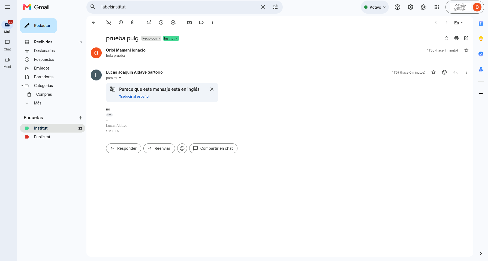
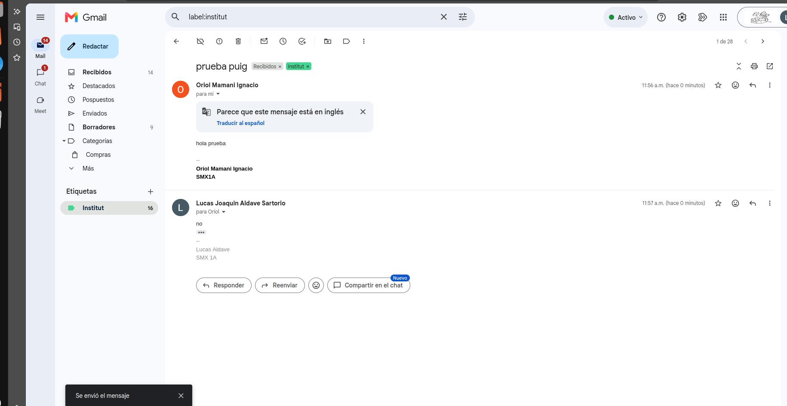
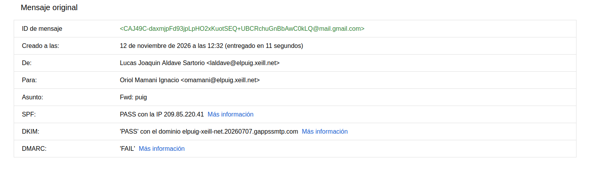

# Viaje de 7 dias de Oriol Mamani Ignacio
Practica RA5

Tabla de seis herramientas de Google
| Herramienta | Propósito | Público |
|---|---|---|
| Gmail | Enviar y recibir correos electrónicos. | Estudiantes, empresas y particulares. |
| Google Drive | Guardar y compartir archivos. | Estudiantes y trabajadores. |
| Google Calendar | Organizar eventos y fechas. | Cualquier usuario. |
| Google Maps | Consultar mapas y planificar rutas. | Viajeros y conductores. |
| Google Sheets | Crear hojas de cálculo y presupuestos. | Estudiantes y empresas. |
| Google Meet | Realizar videollamadas. | Empresas, profesores y estudiantes. |

Diferencia entre IMAP y POP3:

IMAP: Permite consultar los correos desde diferentes dispositivos y mantiene los mensajes sincronizados con el servidor.

POP3: Descarga los correos al dispositivo y normalmente no mantiene la misma sincronización entre varios dispositivos.

IMAP-POP3-SMTP

| Servicio | Servidor | Puerto | Seguridad |
|---|---|---|---|
| IMAP | imap.gmail.com | 993 | SSL/TLS |
| POP3 | pop.gmail.com | 995 | SSL/TLS |
| SMTP | smtp.gmail.com | 465 o 587 | SSL/TLS o STARTTLS |

---

---

# 📸 Evidencias y comprobaciones

## 1. Configuración de etiquetas en Gmail

<table>
<tr>
<td width="45%">

</td>
<td width="55%">
<h3>Creación de etiquetas</h3>
En esta captura se muestra la configuración de las etiquetas de Gmail. Se han creado las etiquetas necesarias para organizar los correos electrónicos y facilitar su clasificación.
</td>
</tr>
</table>

## 2. Prueba de envío y recepción de correo

<table>
<tr>
<td width="45%">

</td>
<td width="55%">
<h3>Correo de prueba</h3>
Se ha enviado un correo electrónico de prueba para comprobar que los filtros de Gmail funcionan correctamente y que los mensajes se clasifican según las condiciones configuradas.
</td>
</tr>
</table>

## 3. Comprobación de la etiqueta desde otra cuenta

<table>
<tr>
<td width="45%">

</td>
<td width="55%">
<h3>Verificación desde otra cuenta</h3>
En esta captura se comprueba cómo aparece el correo recibido desde la otra cuenta de Gmail y si se le ha aplicado correctamente la etiqueta correspondiente.
</td>
</tr>
</table>

## 4. Configuración del protocolo IMAP

<table>
<tr>
<td width="45%">

</td>
<td width="55%">
<h3>Activación de IMAP</h3>
Se muestra la configuración del protocolo IMAP en Gmail, que permite sincronizar los correos electrónicos entre diferentes dispositivos.
</td>
</tr>
</table>

## 5. Comprobación del mensaje original

<table>
<tr>
<td width="45%">

</td>
<td width="55%">
<h3>Autenticación del correo electrónico</h3>
En esta captura se muestran los resultados de las comprobaciones de autenticación:
<ul>
<li><strong>SPF:</strong> PASS.</li>
<li><strong>DKIM:</strong> PASS.</li>
<li><strong>DMARC:</strong> FAIL.</li>
</ul>
SPF y DKIM se validaron correctamente, mientras que DMARC no superó la comprobación.
</td>
</tr>
</table>

## 6. Configuración de la respuesta automática

<table>
<tr>
<td width="45%">

</td>
<td width="55%">
<h3>Respuesta automática</h3>
Se muestra la configuración de la respuesta automática de Gmail. Esta función permite enviar automáticamente un mensaje a las personas que escriben durante un periodo determinado.
</td>
</tr>
</table>

---
