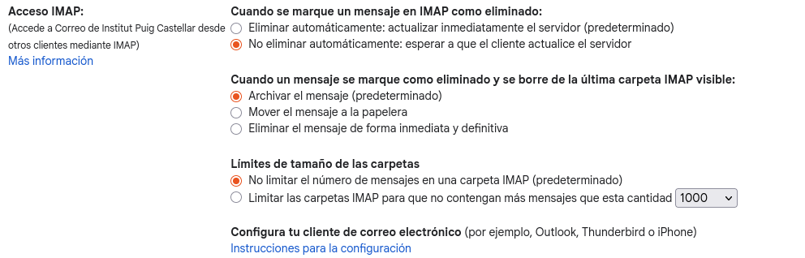

# Viaje de 7 dias de Oriol Mamani Ignacio
Practica RA5

Tabla de seis herramientas de Google
| Herramienta | Propósito | Público |
|---|---|---|
| Gmail | Enviar y recibir correos electrónicos. | Estudiantes, empresas y particulares. |
| Google Drive | Guardar y compartir archivos. | Estudiantes y trabajadores. |
| Google Calendar | Organizar eventos y fechas. | Cualquier usuario. |
| Google Maps | Consultar mapas y planificar rutas. | Viajeros y conductores. |
| Google Sheets | Crear hojas de cálculo y presupuestos. | Estudiantes y empresas. |
| Google Meet | Realizar videollamadas. | Empresas, profesores y estudiantes. |

Diferencia entre IMAP y POP3:

IMAP: Permite consultar los correos desde diferentes dispositivos y mantiene los mensajes sincronizados con el servidor.

POP3: Descarga los correos al dispositivo y normalmente no mantiene la misma sincronización entre varios dispositivos.

IMAP-POP3-SMTP

| Servicio | Servidor | Puerto | Seguridad |
|---|---|---|---|
| IMAP | imap.gmail.com | 993 | SSL/TLS |
| POP3 | pop.gmail.com | 995 | SSL/TLS |
| SMTP | smtp.gmail.com | 465 o 587 | SSL/TLS o STARTTLS |

---

# 📸 Evidencias de la práctica

## 1. Comprobación de etiquetas

<table>
<tr>
<td width="45%" align="center">

</td>
<td width="55%">
<h3>Comprobación de etiquetas</h3>
En esta captura se muestra la comprobación de las etiquetas creadas en Gmail para organizar y clasificar los correos electrónicos.
</td>
</tr>
</table>

---

## 2. Configuración IMAP

<table>
<tr>
<td width="45%" align="center">

</td>
<td width="55%">
<h3>Configuración IMAP</h3>
En esta captura se muestra la configuración del protocolo IMAP en Gmail. Este protocolo permite acceder a los correos electrónicos desde diferentes dispositivos y mantenerlos sincronizados.
</td>
</tr>
</table>

---

## 3. Comprobación del mensaje original

<table>
<tr>
<td width="45%" align="center">

</td>
<td width="55%">
<h3>Mensaje original</h3>
En esta captura se muestran los resultados de autenticación del correo electrónico:
<ul>
<li><strong>SPF:</strong> PASS.</li>
<li><strong>DKIM:</strong> PASS.</li>
<li><strong>DMARC:</strong> FAIL.</li>
</ul>
SPF y DKIM se validaron correctamente, mientras que DMARC no superó la comprobación.
</td>
</tr>
</table>

---

## 4. Respuesta automática

<table>
<tr>
<td width="45%" align="center">

</td>
<td width="55%">
<h3>Respuesta automática</h3>
En esta captura se muestra la configuración de la respuesta automática de Gmail. Esta función permite enviar un mensaje automáticamente a las personas que escriben durante un periodo determinado.
</td>
</tr>
</table>

---
